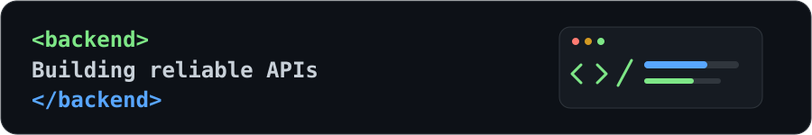

<p align="center">
  
</p>

<h1 align="center">Hi there 👋, I'm Brajesh Pathak</h1>
<h3 align="center">Java Backend Developer | Spring Boot | REST APIs | MySQL</h3>

<p align="center">
  
</p>

<p align="center">
  
  
  
</p>

---

## 👨‍💻 About Me

I'm a B.Tech Information Technology student focused on Java backend development and building practical applications.

- ☕ Learning and building with Java and Spring Boot
- 🌱 Working with Spring Data JPA, Hibernate and REST APIs
- 🗄️ Practicing MySQL, SQL and database relationships
- 🔌 Exploring WebSocket and STOMP for real-time communication
- 🧠 Practicing Data Structures and Algorithms
- 🚀 Building projects to improve my backend engineering skills

## 🛠️ Tech Stack

### Backend
<p>
  
</p>

**Java · Spring Boot · Spring Data JPA · Hibernate · JDBC · Maven · REST APIs · DTOs**

### Database
<p></p>

**MySQL · SQL · JPA**

### Frontend
<p></p>

**HTML · CSS · JavaScript · React · React Native**

### Tools
<p></p>

---

## 🚀 Featured Projects

### 💬 ChatApp — Real-Time Messaging
A React Native application with a Spring Boot backend, chat history, user flows and WebSocket/STOMP real-time messaging.

**Tech:** Java, Spring Boot, JPA/Hibernate, MySQL, REST APIs, WebSocket/STOMP, React Native, Expo.

> Add your actual ChatApp repository URL here.

### 📝 Blog Backend API
A backend API for managing users, posts, comments and categories using layered architecture and relational database mappings.

**Tech:** Java, Spring Boot, Spring Data JPA, Hibernate, MySQL, Maven, Postman.

> Add your actual Blog API repository URL here.

### 🛡️ NagarSuraksha — Civic Issue Reporting
A civic-tech project for reporting local issues with location and media, community upvotes and department-wise tracking.

**Tech:** React, Node.js, Express.js, MongoDB, location APIs.

> Add your actual NagarSuraksha repository URL here.

---

## 🏗️ Backend Architecture

```text
Client
  ↓
REST Controller
  ↓
Service Layer (business logic)
  ↓
Repository Layer
  ↓
Spring Data JPA / Hibernate
  ↓
MySQL
```

## 🧠 DSA Journey

Currently practicing Arrays, Strings, Two Pointers, Sliding Window, Prefix Sum, Kadane's Algorithm, searching, sorting and complexity analysis.

## 📊 GitHub Stats

<p align="center">
  
  
</p>
<p align="center">
  
</p>

---

## 🐍 Contribution Snake

<p align="center">
  <picture>
    <source media="(prefers-color-scheme: dark)" srcset="https://raw.githubusercontent.com/YOUR_GITHUB_USERNAME/YOUR_GITHUB_USERNAME/output/github-contribution-grid-snake-dark.svg">
    <source media="(prefers-color-scheme: light)" srcset="https://raw.githubusercontent.com/YOUR_GITHUB_USERNAME/YOUR_GITHUB_USERNAME/output/github-contribution-grid-snake.svg">
    
  </picture>
</p>

---

## 🎯 Goals

- [x] Learn Java and Spring Boot fundamentals
- [x] Build REST APIs and connect MySQL
- [ ] Improve DSA and problem-solving
- [ ] Build more production-style backend projects
- [ ] Improve automated testing and secure API design
- [ ] Secure a Java Backend Development Internship

## 🤝 Connect With Me

<p align="center">
  <a href="https://github.com/YOUR_GITHUB_USERNAME">
    
  </a>
  <a href="YOUR_LINKEDIN_URL">
    
  </a>
</p>

<p align="center">
  
</p>
